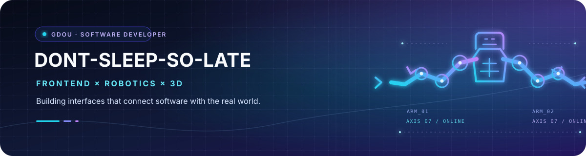

  
  <h2>把复杂系统，做成清晰好用的体验。</h2>
  
前端开发 · 机器人上位机 · 3D 可视化

  

    
    
    
  

---

<strong>⚡ FRONTEND</strong> · Vue 3 / TypeScript &nbsp; • &nbsp; <strong>🤖 ROBOTICS</strong> · 3D / MQTT &nbsp; • &nbsp; <strong>🖥️ DESKTOP</strong> · Electron / Vite

### 👋 关于我

我喜欢把复杂的业务流程、设备状态和实时数据，整理成直观、可靠、容易上手的产品界面。平时主要使用 Vue 3、TypeScript 和 Electron，也在机器人软件与 3D 可视化方向持续实践。

### ⚡ 工具箱

  
  
  
  
  
  
  

### 🚀 精选作品

<table>
  <tr>
    <td width="50%" valign="top">
      ⭐ FEATURED BUILD
      <h4>🤖 7-DOF 人形双臂上位机</h4>
      
面向双臂机器人的控制与监控界面：设备配置、实时状态、3D 模型和消息交互。

      
Vue 3 · Electron · Three.js · MQTT

      <a href="https://gitee.com/dont-sleep-so-late/7-dof_upper">查看公开项目 ↗</a>
    </td>
    <td width="50%" valign="top">
      WEB APPLICATION
      <h4>🏫 GUOD-SSM-front</h4>
      
广东海洋大学体育管理系统前端。

      
Vue

      <a href="https://github.com/dont-sleep-so-late/GUOD-SSM-front">查看项目 ↗</a>
    </td>
  </tr>
  <tr>
    <td width="50%" valign="top">
      FRONTEND PROJECT
      <h4>🧩 yyt</h4>
      
Vue 3 与 TypeScript 前端项目。

      
Vue 3 · TypeScript

      <a href="https://github.com/dont-sleep-so-late/yyt">查看项目 ↗</a>
    </td>
    <td width="50%" valign="top">
      PORTFOLIO
      <h4>🌐 个人网站</h4>
      
网站与线上作品入口。

      
Portfolio · Web

      <a href="https://dont-sleep-so-late.github.io">访问网站 ↗</a>
    </td>
  </tr>
</table>

  
<strong>BUILD · VISUALIZE · CONNECT</strong>

  欢迎交流前端工程、机器人软件与可视化。

